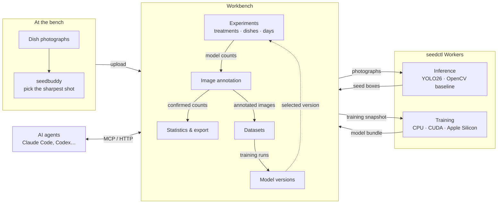

# SeedBuddy

English · [简体中文](README.zh-CN.md)

SeedBuddy is a workbench for seed germination experiments. It counts the seeds in culture-dish photographs with an object detector, lets people correct the results through annotation that also builds training data, and summarizes germination by treatment over time.

## Features

- **Experiment records**: treatments, replicate dishes and observation days, with each photograph and count kept against its dish and day.
- **Automatic counting**: the built-in seed model classifies every seed as germinated, ungerminated, empty or dead.
- **Image annotation**: box and classify the seeds on a photograph, starting from the detector's output or an AI agent's proposal. Annotated images give the experiment confirmed counts and become training data.
- **Model training**: train new detector versions from annotated images and compare them before switching.
- **Hand counts and exclusions**: enter counts made at the bench, and leave unclear photographs or contaminated dishes out of the statistics.
- **Statistics and export**: germination rate, mean, SD and SE by treatment and day, exported to Excel.
- **Photo preparation**: the [`seedbuddy`](packages/seedbuddy/README.md) CLI picks the sharpest countable photograph of each dish before upload.
- **AI agents**: agents can keep experiment records, annotate images and run training over MCP and HTTP.

## Architecture

- **Workbench**: TypeScript, React 19, [TanStack Start](https://tanstack.com/start) and [Bun](https://bun.sh); PostgreSQL with Drizzle ORM; S3-compatible object storage; [Better Auth](https://better-auth.com).
- **Detection**: [Ultralytics](https://docs.ultralytics.com) YOLO26, with a traditional OpenCV detector as the baseline. The dish is located with OpenCV, and training and inference look only inside it.
- **Workers**: [`seedctl`](docs/seedctl.md) runs inference and training on your own machines (CPU, CUDA or Apple Silicon).
- **Agent access**: one set of [operations](docs/agent-api.md) served over HTTP and as an [MCP](https://modelcontextprotocol.io) server, plus a separate MCP server for [AI annotation](docs/ai-annotation.md) whose results wait for a person to confirm.

## Repository

| Path | Contents |
| --- | --- |
| `web/` | The workbench: interface, server, database schema, Agent API and MCP servers |
| `src/seedctl/` | `seedctl`: Workers, dataset transfer, detection and training |
| `packages/seedbuddy/` | `seedbuddy`: photo sorting and review |
| `docs/` | Design and reference documentation |

Setup, deployment and verification are covered in [Development](docs/development.md).

## Documentation

- [Records, models and datasets](docs/domain.md): experimental design, model lifecycle and dataset transfer.
- [Readings](docs/readings.md): counts, exclusions, rates, summaries and the spreadsheet.
- [Images](docs/images.md): canonical pixels, dish analysis and maintenance.
- [seedctl](docs/seedctl.md): Workers, local training and model delivery.
- [seedbuddy](packages/seedbuddy/README.md): photograph sorting and review.
- [Agent API](docs/agent-api.md): HTTP and MCP access to application operations.
- [AI annotation](docs/ai-annotation.md): the annotation MCP server, plus the [annotator](docs/ai-annotation-prompts/annotator.md) and [coordinator](docs/ai-annotation-prompts/coordinator.md) prompts.
- [Accounts](docs/accounts.md): sign-in, administration and integrations.
- [Architecture](docs/architecture.md) and [Backend architecture](docs/backend-architecture.md): source boundaries, contracts, services and persistence.
- [Interface](docs/interface.md): UI components, page composition and interaction rules.
- [Development](docs/development.md): setup, deployment and verification.

## License

SeedBuddy is licensed under the [GNU Affero General Public License v3.0 or later](LICENSE).
