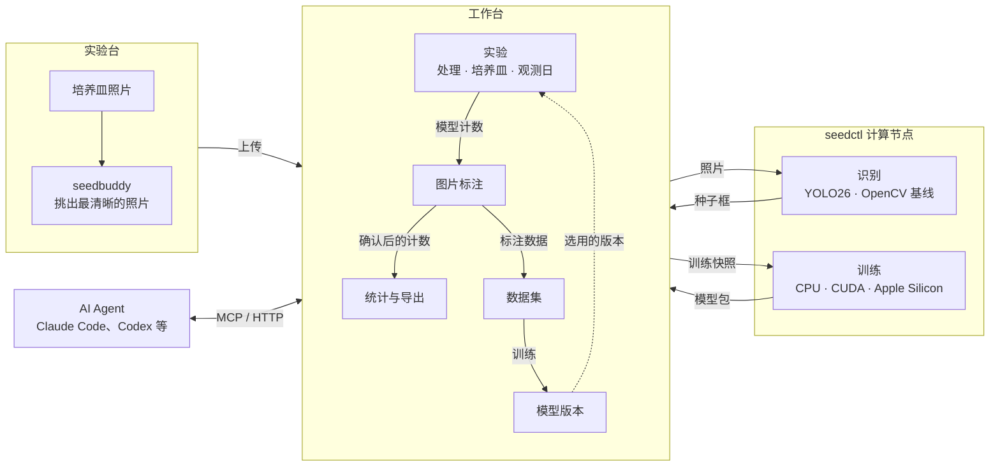

# SeedBuddy

[English](README.md) · 简体中文

SeedBuddy 是一个种子萌发试验工作台。它用目标检测模型对培养皿照片中的种子计数，通过人工标注修正结果、积累训练数据，并按处理汇总萌发随时间的变化。

## 功能

- **实验记录**：处理、重复培养皿和观测日，每张照片和每个计数都对应到具体的培养皿和观测日。
- **自动计数**：内置的种子萌发模型把每颗种子分为已萌发、未萌发、空胚、死亡四类。
- **图片标注**：在照片上框选种子并标注类别，可以从模型识别结果或 AI Agent 的标注建议开始修改。标注过的图片为实验提供确认后的计数，同时成为训练数据。
- **模型训练**：用标注数据训练新的模型版本，比较后再切换。
- **手工录入与不计入统计**：录入实验台上直接数的计数；不清晰的照片、污染的培养皿可以不计入统计。
- **统计与导出**：按处理、按观测日给出萌发率及均值、标准差、标准误，可导出 Excel。
- **照片整理**：命令行工具 [`seedbuddy`](packages/seedbuddy/README.md) 在上传前为每皿挑出最清晰、可计数的照片。
- **AI Agent**：Agent 可以通过 MCP 和 HTTP 维护实验记录、标注图片、发起训练。

## 架构

- **工作台**：TypeScript、React 19、[TanStack Start](https://tanstack.com/start)、[Bun](https://bun.sh)；PostgreSQL + Drizzle ORM；S3 兼容的对象存储；[Better Auth](https://better-auth.com)。
- **检测**：[Ultralytics](https://docs.ultralytics.com) YOLO26，以传统 OpenCV 检测器为基线。用 OpenCV 定位培养皿，训练和识别只看皿内区域。
- **计算节点**：[`seedctl`](docs/seedctl.md) 在你自己的机器上运行识别和训练（CPU、CUDA 或 Apple Silicon）。
- **Agent 接入**：同一套[操作](docs/agent-api.md)同时以 HTTP 和 [MCP](https://modelcontextprotocol.io) 服务提供；另有独立的 [AI 标注](docs/ai-annotation.md) MCP 服务，标注结果需经人确认。

## 仓库结构

| 路径 | 内容 |
| --- | --- |
| `web/` | 工作台：界面、服务端、数据库结构、Agent API 与 MCP 服务 |
| `src/seedctl/` | `seedctl`：计算节点、数据集传输、检测与训练 |
| `packages/seedbuddy/` | `seedbuddy`：照片整理与挑选 |
| `docs/` | 设计与参考文档（英文） |

开发环境、部署和验证见 [Development](docs/development.md)。

## 文档

以下文档为英文。

- [Records, models and datasets](docs/domain.md)：实验设计、模型生命周期、数据集传输。
- [Readings](docs/readings.md)：计数、不计入统计、比率、汇总与导出表格。
- [Images](docs/images.md)：图片标准化、培养皿检测与后台维护。
- [seedctl](docs/seedctl.md)：计算节点、本地训练与模型交付。
- [seedbuddy](packages/seedbuddy/README.md)：照片整理与挑选。
- [Agent API](docs/agent-api.md)：通过 HTTP 和 MCP 调用应用操作。
- [AI annotation](docs/ai-annotation.md)：标注 MCP 服务，以及 [annotator](docs/ai-annotation-prompts/annotator.md) 和 [coordinator](docs/ai-annotation-prompts/coordinator.md) 提示词。
- [Accounts](docs/accounts.md)：登录、账户管理与集成。
- [Architecture](docs/architecture.md)、[Backend architecture](docs/backend-architecture.md)：代码边界、契约、服务与持久化。
- [Interface](docs/interface.md)：界面组件、页面组成与交互规则。
- [Development](docs/development.md)：开发环境、部署与验证。

## 许可

[MIT](LICENSE)
